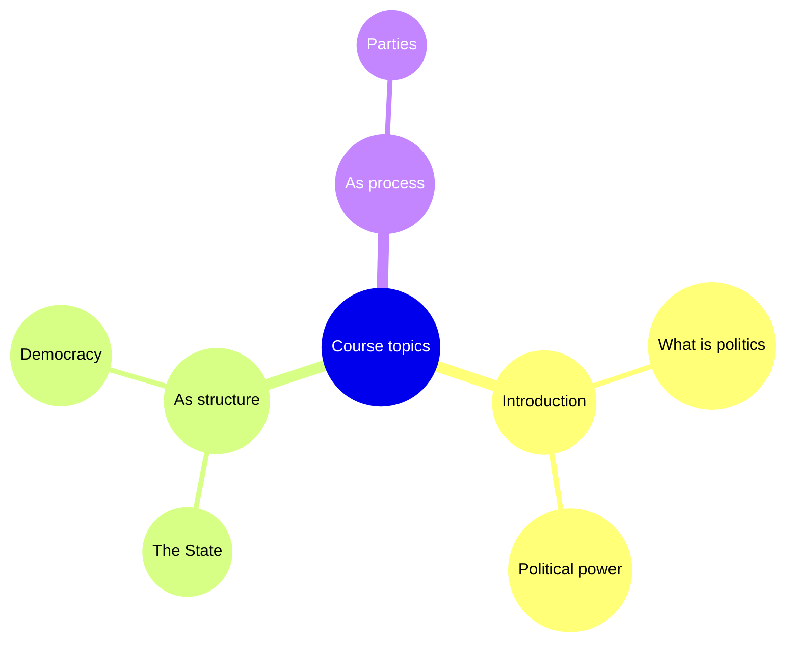

# ClassScribe

**Turn any audio playing on your Mac into study notes — local or cloud transcription, free AI summaries and diagrams.**

ClassScribe captures the internal audio of your Mac (a lecture video, a recorded
call, a podcast), transcribes it with [whisper.cpp](https://github.com/ggerganov/whisper.cpp)
(local, offline, Metal-accelerated) or via [Groq Cloud](https://console.groq.com)
(free tier, no local GPU needed), and generates a study **summary**, **outline**
and **Mermaid diagram** with a free LLM. All free, no subscriptions.

```
┌───────────┐     ┌──────────────┐     ┌─────────────────────┐     ┌───────────────────────┐
│  System   │ ──▶ │  BlackHole   │ ──▶ │  Transcription:     │ ──▶ │  LLM (Groq free)      │
│  audio    │     │ (virtual mic)│     │  whisper.cpp / Groq │     │  summary+outline+diagram│
└───────────┘     └──────────────┘     └─────────────────────┘     └───────────────────────┘
     play a lecture      ffmpeg capture      .txt/.srt/.vtt              .md study notes
```

> **Status:** local whisper.cpp transcription works today. The Groq cloud
> transcription backend is the configured default but is **not implemented yet**
> ([tracked here](https://github.com/pmolina18/classscribe/issues)). Until it
> lands, run with `--transcription-provider local` (see Usage).

## Why

I built this to study for my university degree: record each video lecture, get a
faithful transcript, and have an LLM turn it into a revision summary and a
hierarchical outline — all automatically, all free. It works for any audio your
Mac can play.

## Features

- 🎙️ **Capture internal audio** on macOS via BlackHole (what you *hear*, cleanly, no microphone).
- 📝 **Transcription, your choice of backend**:
  - `local` — whisper.cpp + `large-v3-turbo`, offline, private, GPU-accelerated (**available now**).
  - `groq` — Groq Cloud free tier, no local GPU or model download needed (**coming soon**, default).
- 🧠 **Free AI summaries** via [Groq Cloud](https://console.groq.com) (free tier), or any OpenAI-compatible endpoint — including **Ollama** for 100% local, private summaries.
- 📊 **Mermaid diagrams** from the lecture content — mindmap, timeline, flowchart, or `auto`. Renders natively on GitHub, VS Code and Obsidian; no image API, no extra key.
- 🧩 **Outputs**: `.txt`, `.srt`, `.vtt` transcripts + `-summary.md`, `-outline.md` and `-diagram.md`.
- 🛠️ **One command**: `classscribe pipeline` records → transcribes → summarizes → diagrams.
- 🔎 **`classscribe config`** prints the effective configuration at any time.

## Requirements (all free)

| Tool | Install | Purpose |
|------|---------|---------|
| [BlackHole 2ch](https://existential.audio/blackhole/) | `brew install blackhole-2ch` | Capture internal audio (recording only) |
| [ffmpeg](https://ffmpeg.org) | `brew install ffmpeg` | Audio I/O |
| [whisper.cpp](https://github.com/ggerganov/whisper.cpp) | `brew install whisper-cpp` | Local transcription (`local` backend) |
| Python ≥ 3.11 | `brew install python` | Runs ClassScribe |
| A free [Groq API key](https://console.groq.com/keys) | — | AI summaries (and cloud transcription) |

> **macOS only** for recording (BlackHole + avfoundation). Transcription and
> summarization work anywhere Python runs; the `local` backend additionally
> needs whisper.cpp.

## Install

```bash
git clone https://github.com/pmolina18/classscribe.git
cd classscribe
pip install -e .
```

Using the **local** backend? Download the whisper model (~1.5 GB, one time):

```bash
classscribe setup
```

(Not needed for the `groq` cloud backend.)

## Audio routing (one-time macOS setup)

To capture what you hear *and* keep hearing it, create a **Multi-Output Device**:

1. Open **Audio MIDI Setup**.
2. Click **+** (bottom-left) → **Create Multi-Output Device**.
3. Check both **BlackHole 2ch** and your speakers/headphones.
4. Enable **Drift Correction** on BlackHole.
5. Before recording, set system output (🔊 menu) to that Multi-Output Device.

## Configure the LLM

Get a free key at [console.groq.com/keys](https://console.groq.com/keys), then:

```bash
export GROQ_API_KEY="your-groq-key"
```

> Groq rotates its model lineup. ClassScribe defaults to a current production
> model (`openai/gpt-oss-20b`); if you ever get a `model_not_found` error, pick
> another from [console.groq.com/docs/models](https://console.groq.com/docs/models)
> and set it via `[llm] model` in your config.

Prefer **fully local** summaries? Run [Ollama](https://ollama.com) and point the
config at it — see `.classscribe.toml.example`. No API key, nothing leaves your Mac.

## Usage

> While the Groq transcription backend is in progress, add
> `--transcription-provider local` to any transcribing command (or set
> `[transcription] provider = "local"` in your config).

**All in one** (record → transcribe → summarize):

```bash
classscribe pipeline my-lecture --transcription-provider local
# plays? press Ctrl+C to stop → transcript + summary appear automatically
```

**Step by step:**

```bash
classscribe record my-lecture        # Ctrl+C to stop
classscribe transcribe ~/ClassScribe/recordings/my-lecture-*.wav --transcription-provider local
classscribe summarize ~/ClassScribe/transcripts/my-lecture-*.txt
```

**Transcribe a file you already have** (no recording needed):

```bash
classscribe transcribe ~/Downloads/lecture.mp4 --language es --transcription-provider local
```

**Make a diagram from a transcript** (summaries and diagrams use the cloud LLM,
so no `--transcription-provider` needed):

```bash
classscribe summarize ~/ClassScribe/transcripts/my-lecture.txt
classscribe diagram   ~/ClassScribe/transcripts/my-lecture.txt --diagram-type auto
```

The `-diagram.md` contains a Mermaid block that renders directly on GitHub:



> Diagrams are LLM-generated and *occasionally* need a tiny manual edit (a
> stray label character). ClassScribe extracts the Mermaid block automatically;
> if the model returns no valid block, the raw response is kept with a warning
> so you never lose output.

**See the resolved configuration** (handy for debugging; secrets are redacted):

```bash
classscribe config
```

Outputs land in `~/ClassScribe/{recordings,transcripts,summaries}/` (configurable).

## Configuration

Copy `.classscribe.toml.example` to `.classscribe.toml` and edit, or use flags /
env vars. Precedence: **CLI flag > env var > config file > built-in default**.

| Setting | Flag | Env var | Config file |
|---------|------|---------|-------------|
| Workspace folder | `--workspace` | `CLASSSCRIBE_WORKSPACE` | `workspace` |
| Language | `--language` | `CLASSSCRIBE_LANGUAGE` | `language` |
| Transcription backend | `--transcription-provider` | `CLASSSCRIBE_TRANSCRIPTION_PROVIDER` | `[transcription] provider` |
| Diagram type | `--diagram-type` | `CLASSSCRIBE_DIAGRAM_TYPE` | `[diagrams] type` |
| LLM API key | — | `GROQ_API_KEY` | `[llm] api_key_env` |

Run `classscribe config` to see exactly what is in effect.

## Privacy & cost

- **`local` transcription stays on your Mac** — whisper.cpp is fully offline.
- **`groq` transcription** (when available) sends your audio to Groq's free-tier
  cloud API.
- **Summaries and diagrams** send the *transcript text* to the LLM endpoint you
  choose. With Groq that's a free-tier cloud call; with Ollama it stays local.
- Groq's free tier has rate limits and a 100 MB per-file cap for transcription
  (fine for class recordings). No credit card.

## License

MIT — see [LICENSE](LICENSE).
