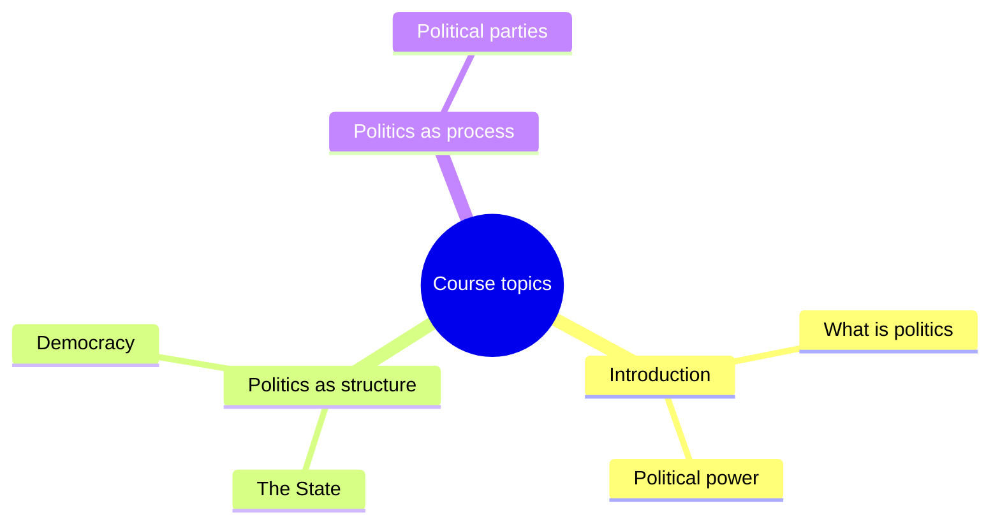

# ClassScribe

[](https://github.com/pmolina18/classscribe/actions/workflows/ci.yml)
[](LICENSE)

ClassScribe turns whatever is playing on your Mac into study notes. Start a
recorded lecture, run one command, and you get a transcript, a summary, an
outline and a concept map you can open straight on GitHub.

I wrote it for my own degree. I study through recorded video lectures, and
taking notes by hand was eating the time I wanted to spend actually studying.
It works with any audio, though: talks, podcasts, meetings.

Everything it uses is free. Transcription runs either on your machine with
[whisper.cpp](https://github.com/ggerganov/whisper.cpp) or on
[Groq](https://console.groq.com)'s free tier, and the notes come from a free
LLM.

## How it works

```
your Mac's audio ─▶ BlackHole ─▶ transcription ─▶ LLM ─▶ notes
                    (capture)    whisper.cpp       Groq   summary
                                 or Groq Whisper          outline
                                                          Mermaid diagram
```

1. **Record.** [BlackHole](https://existential.audio/blackhole/) exposes the
   system output as an input device, so ClassScribe records what you hear,
   not what your microphone picks up.
2. **Transcribe.** The audio goes to Groq's hosted Whisper (the default, no GPU
   needed) or to a local whisper.cpp model that never leaves your Mac. Either
   way you get `.txt`, `.srt` and `.vtt` files.
3. **Write the notes.** The transcript is sent to an LLM, which produces a
   summary, an outline and a Mermaid diagram. The prompts tell it to stick to
   what was said in the lecture and not invent anything.

ClassScribe has no Python dependencies. The Groq calls are plain `urllib`
requests, and the heavy lifting is done by ffmpeg and whisper.cpp.

## Quick start

```bash
brew install blackhole-2ch ffmpeg
git clone https://github.com/pmolina18/classscribe.git
cd classscribe
pip install -e .

export GROQ_API_KEY="your-groq-key"   # free at console.groq.com/keys

classscribe pipeline my-first-lecture --duration 20s
```

Before that last command, follow the one-time
[audio routing](#audio-routing) step and start something playing. When it
finishes, your files are in `~/ClassScribe/`.

## Requirements

| What | Install | Needed for |
|------|---------|------------|
| macOS | | Recording (BlackHole and avfoundation are Mac-only) |
| Python 3.11+ | `brew install python` | Everything |
| ffmpeg | `brew install ffmpeg` | Recording and audio conversion |
| BlackHole 2ch | `brew install blackhole-2ch` | Recording |
| Groq API key | [console.groq.com/keys](https://console.groq.com/keys) | Cloud transcription and notes |
| whisper.cpp | `brew install whisper-cpp` | Only the `local` transcription backend |

If you already have audio or video files, you can skip BlackHole and run
`transcribe` on them directly. That part works on any OS with Python and ffmpeg.

## Audio routing

You need to do this once. It lets BlackHole capture the audio while you keep
hearing it.

1. Open **Audio MIDI Setup**.
2. Click **+** in the bottom-left corner and choose **Create Multi-Output Device**.
3. Tick **BlackHole 2ch** and your speakers or headphones.
4. Enable **Drift Correction** on the BlackHole row.

Whenever you want to record, set your sound output to that Multi-Output Device
from the menu bar. If you forget, the recording will be silent.

## Usage

### Record a lecture and get everything

```bash
classscribe pipeline history-unit-3 --duration 45m
```

`--duration` takes whatever is easiest to type: `90`, `20s`, `5m`, `1h30m`,
`45:00` or `1:30:00`. If you leave it out, recording runs until you press
Ctrl+C, and then the rest of the pipeline continues on its own.

### Run the steps one at a time

```bash
classscribe record history-unit-3 --duration 45m
classscribe transcribe ~/ClassScribe/recordings/history-unit-3-*.wav --language es
classscribe summarize  ~/ClassScribe/transcripts/history-unit-3-*.txt
classscribe diagram    ~/ClassScribe/transcripts/history-unit-3-*.txt
```

### Transcribe a file you already have

```bash
classscribe transcribe ~/Downloads/lecture.mp4 --language es
```

Anything ffmpeg can read works: mp4, mkv, m4a, mp3, wav and more.

### Transcribe offline

```bash
classscribe setup     # downloads the whisper model once, about 1.5 GB
classscribe transcribe ~/Downloads/lecture.mp4 --language es --transcription-provider local
```

Pass `--language` with the local backend. Without it, whisper.cpp assumes
English.

### Diagrams

`classscribe diagram` writes a `-diagram.md` file containing a Mermaid block.
GitHub, VS Code and Obsidian render it without any extra tooling. Here is a
trimmed version of what it produced for my Intro to Politics lecture:



Choose a shape with `--diagram-type mindmap`, `timeline` or `flowchart`. The
default, `auto`, lets the model decide based on the content. LLM-generated
Mermaid sometimes needs a small manual fix. If the model returns something
ClassScribe can't parse, it keeps the raw output in the file with a warning,
so you never lose the result.

### Check your settings

```bash
classscribe config
```

This prints the settings ClassScribe is actually using. It shows whether an
API key is set but never prints the key.

## Output

Files are saved under `~/ClassScribe/` by default:

```
~/ClassScribe/
├── recordings/    history-unit-3-20261012-101500.wav
├── transcripts/   .txt  .srt  .vtt
└── summaries/     -summary.md  -outline.md  -diagram.md
```

## Configuration

Every setting can be passed as a flag, set as an environment variable, or
written to a `.classscribe.toml` file (copy `.classscribe.toml.example` to
start). Flags override environment variables, which override the file.

| Setting | Flag | Environment variable | Config file |
|---------|------|----------------------|-------------|
| Output folder | `--workspace` | `CLASSSCRIBE_WORKSPACE` | `workspace` |
| Language | `--language` | `CLASSSCRIBE_LANGUAGE` | `language` |
| Transcription backend | `--transcription-provider` | `CLASSSCRIBE_TRANSCRIPTION_PROVIDER` | `[transcription] provider` |
| Diagram type | `--diagram-type` | `CLASSSCRIBE_DIAGRAM_TYPE` | `[diagrams] type` |
| API key | | `GROQ_API_KEY` | `[llm] api_key_env` (the variable's name) |

### Models

Out of the box, ClassScribe uses `whisper-large-v3-turbo` for transcription
and `openai/gpt-oss-20b` for the notes. Groq retires models from time to time.
If you get a `model_not_found` error, pick a current model from
[Groq's model list](https://console.groq.com/docs/models) and set it with
`[transcription] groq_model` or `[llm] model`.

### Fully local

You can keep everything on your machine by pointing the LLM settings at
[Ollama](https://ollama.com) (the example config shows how) and using
`--transcription-provider local`. Use the two together: the Groq transcription
backend talks to the same endpoint as the LLM, so it won't work against Ollama.

## Privacy and cost

- The **local** backend never sends audio anywhere.
- The **groq** backend uploads your audio to Groq. The free tier accepts files
  up to 100 MB. ClassScribe's recordings are 16 kHz mono WAV, about 1.9 MB per
  minute, so that limit is roughly 50 minutes of recording. For longer
  lectures, use the local backend (no size limit) or transcribe a compressed
  copy (an m4a or mp3 of the same lecture is far smaller).
- Summaries and diagrams send the **transcript text** to whichever LLM you
  configure: Groq by default, or Ollama if you want it to stay local.
- Groq's free tier needs no credit card. It does have rate limits; check
  [Groq's rate limits page](https://console.groq.com/docs/rate-limits) for
  the current numbers.

## Development

```bash
python -m venv .venv && source .venv/bin/activate
pip install -e . pytest ruff
ruff check classscribe tests
pytest -q
```

CI runs the same checks on Python 3.11 and 3.12 for every push and pull
request. Open issues are on the
[issue tracker](https://github.com/pmolina18/classscribe/issues), and
contributions are welcome.

## License

[MIT](LICENSE)
